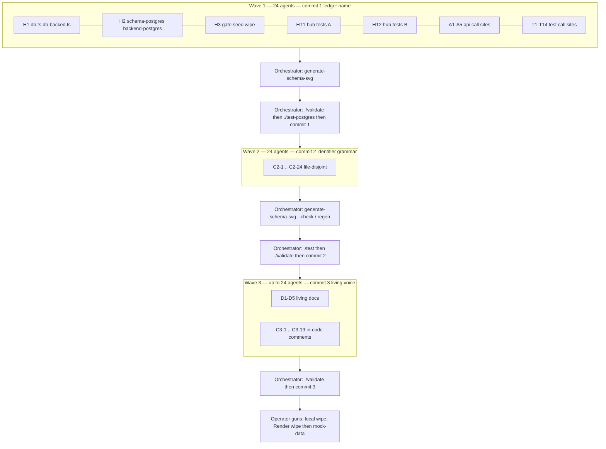

# Rename pairs to message_pairs Implementation Plan

> **For agentic workers:** REQUIRED SUB-SKILL: Use
> superpowers:subagent-driven-development (recommended) or
> superpowers:executing-plans to implement this plan
> task-by-task. Steps use checkbox (`- [ ]`) syntax for
> tracking.
>
> This plan is a **dependency DAG for up to 24 agents**.
> Do not serialize independent shards. Do not use git
> worktrees (repo rule). Agents share one working tree
> and MUST stay file-disjoint inside a wave.

**Goal:** One name for the ledger — SQL `message_pairs`,
store `db.messagePairs`, stored row `MessagePairEntity` —
in three validate-green commits, then operator guns.

**Architecture:** Wipe-then-reseed cutover. No `ALTER`, no
SQL view, no TypeScript alias. Schema-svg snake_cases the
`DbStores` property and demands it match `TABLE_NAMES`, so
the store rename and the SQL rename land in the same
commit. Identifier grammar and living prose wait for
commits 2 and 3. Leftover `pairs` is a retired object:
dropped by wipe, refused by boot, refused by seed before
`ensureTables`.

**Tech Stack:** TypeScript ES2024 (`node --strip-types`),
postgres.js behind `api/postgres-client.ts`,
`HistoryEntityStore` on the message plane, `./validate`
(tsc + `./test` + 78-char lint + schema-svg `--check` +
api-docs `--check`), `./test-postgres` for DDL/wipe/seed.

**Spec:**
`docs/superpowers/specs/2026-08-22-rename-pairs-to-message-pairs-design.md`

---

## How to run this DAG

The orchestrator (this session) dispatches. Subagents do
not read this file for scope — the orchestrator pastes
the **Shared transforms** plus the agent's **Files** list
plus the hub snippets that agent owns.

Every subagent prompt begins with `Go to Medium Church!`
then:

- 78-character max line, 4-space indent.
- Commandments: Uniformity, Clarity, Simplicity.
- Abominations this work risks: Unbidden Helper Code,
  Test Weakening, Premature Generalization, Foreign
  Tongues (do not invent a second name).
- Patterns: snake_case storage / camelCase domain,
  HTTP-verb adapter naming, no `any` from boundaries.
- Apply ONLY the named transform (C1, C2, or C3).
- Do not commit. Do not run `./validate`. Do not touch
  files outside the assigned list.
- Do not rename data values (`'pair-1'`).
- Do not rewrite `docs/superpowers/specs/` or
  `docs/superpowers/plans/` (including this file).
- Return: files touched, substitutions applied, anything
  skipped and why.

Peak concurrency is **24**. Waves do not overlap.
Uncommitted work from wave N must become a green commit
before wave N+1 starts.



Intra-wave: all 24 agents of a wave run in parallel.
`SCHEMA.svg` regeneration is an orchestrator barrier
after Wave 1 returns (needs H1 `messagePairs` and H2
DDL both on disk). After Wave 2, run
`./generate-schema-svg --check`; regenerate if
`PairEntity` → `MessagePairEntity` drifted the picture.

---

## File map

### Commit 1 — ledger name (SQL + store + pins)

Hub (unique semantics; snippets below):

- `api/db.ts` — `DbStores.messagePairs`, `TABLE_NAMES`,
  `TABLE_INDEXES`
- `api/db-backed.ts` — store field +
  `HistoryEntityStore('message_pairs', …)`; type param
  stays `PairEntity`
- `api/schema-postgres.ts` — `CREATE TABLE message_pairs`
  and `{table}_{suffix}` indexes/constraints
- `api/backend-postgres.ts` — `POSTGRES_DROP_SCHEMA`,
  every `FROM` / `INSERT` / `ON` / `DELETE`,
  `assertMessageTable` returns `'message_pairs'`
- `server/postgres-gate.ts` — leftover `pairs` in
  `assertNoLegacyMessageTables`
- `server/postgres-seed.ts` — legacy gate before
  `ensureTables`
- `server/seed.ts` — emptiness `FROM message_pairs`
- `postgres-wipe` — usage cites `message_pairs` first,
  then leftover `pairs`
- Hub tests listed under HT1 / HT2
- `SCHEMA.svg` — generated, never hand-edited

Call sites (`db.pairs` → `db.messagePairs`; quoted table
`'pairs'` → `'message_pairs'` when it names the ledger):
24 `api/*.ts` files and 70 `tests/*.ts` files listed
under A1–A5 and T1–T14.

### Commit 2 — identifier grammar

`PairEntity` and every TypeScript identifier that
contains the ledger morpheme `pair` / `pairs` / `Pair` /
`PAIRS` and does not already contain `message` /
`Message` / `MESSAGE`. Locals `pairs` / `pair` bound to
ledger rows. Comments that name those symbols. Not
pair-plane prose.

### Commit 3 — living voice

`SCHEMA.md`, `ARCHITECTURE.md`, `AGENTS.md` (the living
operator doc; `CLAUDE.md` / `Claude.md` are `@AGENTS.md`
stubs), `API.md`, `TEST-PLAN.md`, in-code comments in
`api/`, `server/`, `tests/`, `web-app/`.

Leave: historical `docs/superpowers/specs/` and
`docs/superpowers/plans/`; TEST-PLAN line-length
exemption; English “pairing”; TEST-PLAN “Pairs with V7”;
data values such as `'pair-1'`.

---

## Shared transforms

Copy the relevant block into every agent prompt. Do not
paraphrase.

### C1 — ledger name (Wave 1 only)

Replace these exact tokens. Nothing else.

| Match | Replacement | When |
|---|---|---|
| `db.pairs` | `db.messagePairs` | property access |
| `view.pairs` | `view.messagePairs` | same |
| `adapter.pairs` | `adapter.messagePairs` | same |
| `inner.pairs` | `inner.messagePairs` | same |
| `(db.pairs as` | `(db.messagePairs as` | test casts |
| `'pairs'` | `'message_pairs'` | table name: `TABLE_NAMES`, `TABLE_INDEXES` key, `HistoryEntityStore` table, `ensureTables([…])`, `transaction([…])`, `tx.get` / `tx.put` / `tx.getWhere` first arg, `assertMessageTable` / `_table` literals, SQL `FROM` / `INTO` / `ON` / `DELETE FROM` |
| `` `pairs` `` in SQL template strings | `` `message_pairs` `` | backend-postgres |

Do **not** in C1:

- Rename `PairEntity`, `validatePairEntity`,
  `POSTGRES_PAIRS_TABLE` (constant name), `PAIR_ROW`,
  `PAIR_BODY_KEYS`, `requirePair`, `seedPairKey`,
  `documentPairsAt`, `WritePairInput`, locals
  `const pairs` / `const pair`, loop `for (const pair`.
- Rewrite comments that say “pair plane” / “document
  pair” (C3). A comment that cites `db.pairs` as a
  symbol follows C1 (`db.messagePairs`).
- Touch `docs/superpowers/`.
- Rename `'pair-1'` or any other data value.
- Invent `get pairs()` or `type PairEntity = …`.

Keep wrapping at 78 characters after substitution.

### C2 — identifier grammar (Wave 2 only)

Rename a TypeScript or SQL-constant identifier when it
contains the entity morpheme `pair` / `pairs` / `Pair` /
`PAIRS` and does **not** already contain `message` /
`Message` / `MESSAGE`.

Mandatory map (every occurrence, including strings that
name the type in validator errors):

| From | To |
|---|---|
| `PairEntity` | `MessagePairEntity` |
| `validatePairEntity` | `validateMessagePairEntity` |
| `PAIR_BODY_KEYS` | `MESSAGE_PAIR_BODY_KEYS` |
| `PAIR_ROW` | `MESSAGE_PAIR_ROW` |
| `POSTGRES_PAIRS_TABLE` | `POSTGRES_MESSAGE_PAIRS_TABLE` |
| `requirePair` | `requireMessagePair` |
| `seedPairKey` | `seedMessagePairKey` |
| `documentPairsAt` | `documentMessagePairsAt` |
| `operationPairsAt` | `operationMessagePairsAt` |
| `headPairIdAt` | `headMessagePairIdAt` |
| `latchedHeadPairId` | `latchedHeadMessagePairId` |
| `WritePairInput` | `WriteMessagePairInput` |
| `AuthPairSeed` | `AuthMessagePairSeed` |
| `formAuthPair` | `formAuthMessagePair` |
| `DocumentPair` | `DocumentMessagePair` |
| `DocumentPairFormInput` | `DocumentMessagePairFormInput` |
| `formDocumentPairFor` | `formDocumentMessagePairFor` |
| `ifMatchFromPair` | `ifMatchFromMessagePair` |
| `rawIfMatchFromPair` | `rawIfMatchFromMessagePair` |
| `pairResponseBody` | `messagePairResponseBody` |
| `RecordWritePairs` | `RecordWriteMessagePairs` |
| `FlowCreationPairs` | `FlowCreationMessagePairs` |
| `ObjectiveCreationPairs` | `ObjectiveCreationMessagePairs` |
| `IdentityWritePairs` | `IdentityWriteMessagePairs` |
| `WorkOrderCreationPairs` | `WorkOrderCreationMessagePairs` |

Locals bound to ledger rows (including destructures and
parameters):

| From | To |
|---|---|
| `pairs` | `messagePairs` |
| `pair` | `messagePair` |
| `aPair` | `aMessagePair` |
| `allPairs` | `allMessagePairs` |
| `seatPairs` | `seatMessagePairs` |
| `entityPairs` | `entityMessagePairs` |
| `documentPairs` | `documentMessagePairs` |
| `baselinePairs` | `baselineMessagePairs` |
| `opPairs` | `operationMessagePairs` |
| `documentPair` | `documentMessagePair` |
| `projectPair` | `projectMessagePair` |
| `ideaPair` | `ideaMessagePair` |
| `revisionPair` | `revisionMessagePair` |

“Op” is not a word in this voice. That rule applies to
pair-named identifiers this commit moves. It does not
rename every `op` in the repository.

Leave:

- Names that already contain `message`: `MessagePair`,
  `appendMessagePair`, `formMockDataMessagePairs`,
  filenames `message-pair.ts`, `seed-message-pairs.ts`.
- Geometry / scoring that is not the ledger:
  `EdgePair`, `latestPerPair`.
- Data values: `'pair-1'`.
- Pair-plane prose in comments (C3).
- `docs/superpowers/`.

After a rename, keep lines ≤ 78 characters.

### C3 — living voice (Wave 3 only)

Apply to living prose and comments. Not to historical
specs/plans.

| From | To |
|---|---|
| document pair | document message pair |
| operation pair | operation message pair |
| op pair | operation message pair |
| op-pair | operation-message-pair |
| pair plane | message plane |
| pair-plane | message-plane |
| `` `pairs` `` as the table | `` `message_pairs` `` |
| `db.pairs` remaining in prose | `db.messagePairs` |
| `PairEntity` remaining in prose | `MessagePairEntity` |

Genus “message pair” stays. Do not write “message
message pair”. After “document pair” → “document
message pair”, do not apply the genus rule a second
time.

Leave: “pairing”; TEST-PLAN “Pairs with V7”; data
values; `docs/superpowers/`; TEST-PLAN’s line-length
exemption (do not wrap TEST-PLAN entries to 78).

---

## Wave 1 — Commit 1 (24 agents, parallel)

### Task H1: Store surface

**Files:**

- Modify: `api/db.ts`
- Modify: `api/db-backed.ts`

- [ ] **Step 1: Apply this exact surface**

In `api/db.ts`, `DbStores` becomes:

```typescript
export interface DbStores {
    messagePairs: EntityStore<PairEntity>;
}
```

`TABLE_NAMES` / comment / `TABLE_INDEXES`:

```typescript
// The tables of the message plane — one,
// `message_pairs`.
export const TABLE_NAMES = [
    'message_pairs',
];

// The message-plane transaction declaration. Every
// `transaction` / `readTransaction` that touches
// the message plane passes this instead of a
// literal list. Equals TABLE_NAMES.
export const MESSAGE_TABLES = TABLE_NAMES;
```

```typescript
export const TABLE_INDEXES:
    Record<string, readonly TableIndexSpec[]> = {
    message_pairs: [
        'uri_collection', 'request_hash',
    ],
};
```

Leave the `PairEntity` import and the store type
parameter. No alias `pairs`.

In `api/db-backed.ts`:

```typescript
    readonly messagePairs!: EntityStore<PairEntity>;
```

```typescript
    #buildStores(run: TxRunner): DbStores {
        return {
            messagePairs: new HistoryEntityStore(
                'message_pairs', run, validatePairEntity,
            ),
        };
    }
```

Leave `validatePairEntity` and `PairEntity` until C2.

- [ ] **Step 2: Report files touched. Do not commit.**

### Task H2: DDL and backend SQL

**Files:**

- Modify: `api/schema-postgres.ts`
- Modify: `api/backend-postgres.ts`

- [ ] **Step 1: Rewrite DDL; keep the constant name**

`POSTGRES_PAIRS_TABLE` (name stays until C2) body:

```typescript
export const POSTGRES_PAIRS_TABLE =
    String.raw`CREATE TABLE IF NOT EXISTS message_pairs (
    id uuid PRIMARY KEY,
    uri_collection text COLLATE "C" NOT NULL
        CONSTRAINT message_pairs_collection_chk
        CHECK (left(uri_collection, 1) = '/'
           AND right(uri_collection, 1) = '/'),
    uri_id text COLLATE "C" NOT NULL,
    requester_identity_id text COLLATE "C" NOT NULL,
    method text COLLATE "C" NOT NULL
        CONSTRAINT message_pairs_method_chk
        CHECK (method ~ '^[A-Z]+$'),
    request_at text COLLATE "C" NOT NULL
        CONSTRAINT message_pairs_request_at_chk
        CHECK (request_at ~
        '^\d{4}-\d{2}-\d{2}T\d{2}:\d{2}:\d{2}\.\d{6}Z$'),
    request_hash text COLLATE "C" NOT NULL
        CONSTRAINT message_pairs_request_hash_chk
        CHECK (request_hash ~ '^[0-9a-f]{64}$'),
    request bytea NOT NULL,
    response_at text COLLATE "C" NOT NULL
        CONSTRAINT message_pairs_response_at_chk
        CHECK (response_at ~
        '^\d{4}-\d{2}-\d{2}T\d{2}:\d{2}:\d{2}\.\d{6}Z$'),
    version text COLLATE "C" NOT NULL
        CONSTRAINT message_pairs_version_chk
        CHECK (version ~ '^[0-9a-f]{64}$'),
    response bytea NOT NULL,
    operation_id uuid NOT NULL
);`;
```

`POSTGRES_INDEXES`:

```typescript
export const POSTGRES_INDEXES =
    String.raw`CREATE INDEX IF NOT EXISTS message_pairs_address
    ON message_pairs (uri_collection, uri_id, response_at, id);
CREATE INDEX IF NOT EXISTS message_pairs_collection
    ON message_pairs (uri_collection, response_at, id);
CREATE INDEX IF NOT EXISTS message_pairs_replay
    ON message_pairs (request_hash);
CREATE INDEX IF NOT EXISTS message_pairs_version
    ON message_pairs (uri_collection, uri_id, version);
CREATE INDEX IF NOT EXISTS message_pairs_body
    ON message_pairs
    USING gin (message_body(response) jsonb_path_ops);`;
```

Columns, key lists, and `message_body(bytea)` do not
change. Wrap at 78 where the old file already did;
index `CREATE INDEX` lines may exceed 78 as the old
`pairs_address` line did — match neighboring wrap.

- [ ] **Step 2: Wipe list and every SQL string**

```typescript
export const POSTGRES_DROP_SCHEMA =
    'DROP TABLE IF EXISTS message_pairs;\n'
    + 'DROP TABLE IF EXISTS pairs;\n'
    + 'DROP TABLE IF EXISTS responses;\n'
    + 'DROP TABLE IF EXISTS requests;\n'
    + 'DROP TABLE IF EXISTS schema_marker;\n'
    + 'DROP FUNCTION IF EXISTS message_body(bytea);';
```

`assertMessageTable`:

```typescript
function assertMessageTable(
    table: string,
): 'message_pairs' {
    if (table === 'message_pairs') {
        return table;
    }
    throw new Error('unknown table: ' + table);
}
```

`assertIndexedColumn` table parameter and every
`_table: 'pairs'` become `'message_pairs'`. Every
`FROM pairs` / `DELETE FROM pairs` / `INSERT INTO pairs`
/ `ON pairs` becomes `message_pairs`. After the legacy
gate, this file does not `FROM pairs`.

- [ ] **Step 3: Report. Do not regenerate SCHEMA.svg.
      Do not commit.**

### Task H3: Boot, seed, wipe usage

**Files:**

- Modify: `server/postgres-gate.ts`
- Modify: `server/postgres-seed.ts`
- Modify: `server/seed.ts`
- Modify: `postgres-wipe`

- [ ] **Step 1: Legacy gate includes leftover `pairs`**

```typescript
export async function assertNoLegacyMessageTables(
    sql: SqlClient,
): Promise<void> {
    const names = [
        'pairs', 'requests', 'responses',
    ] as const;
    for (const name of names) {
        const rows = await sql.query<{
            rel: string | null;
        }>`
            SELECT to_regclass(${name}) AS rel
        `;
        if (rows[0]?.rel !== null
            && rows[0]?.rel !== undefined) {
            throw new Error(LEGACY_MESSAGE_TABLES);
        }
    }
}
```

Leftover `pairs` is the same class of retired object as
`requests` / `responses`. Error string stays
`LEGACY_MESSAGE_TABLES`.

- [ ] **Step 2: Seed order**

In `server/postgres-seed.ts`, after `assertUtf8(sql)`
and before `ensureTables`:

```typescript
        await assertUtf8(sql);
        await assertNoLegacyMessageTables(sql);
        const adapter = new BackedDbAdapter(
```

Import `assertNoLegacyMessageTables` from
`./postgres-gate.ts` beside the existing gate imports.

- [ ] **Step 3: Emptiness reads `message_pairs` only**

In `server/seed.ts` `isDatabaseEmpty`:

```typescript
    const rows = await sql.query<{
        message_pairs: boolean;
        marker: boolean;
    }>`
        SELECT
            EXISTS (
                SELECT 1 FROM message_pairs
            ) AS message_pairs,
            EXISTS (
                SELECT 1 FROM schema_marker
            ) AS marker
    `;
    const row = rows[0];
    if (row === undefined) return true;
    return !row.message_pairs && !row.marker;
```

After the legacy gate, seed does not `FROM pairs`.

- [ ] **Step 4: Wipe usage**

`postgres-wipe` usage body (the `USAGE` heredoc):

```
Drop the message plane (message_pairs), leftover
pairs, retired leftovers (responses, requests),
schema_marker, and message_body. Does not seed.
--postgres is required and has no default.
--postgres render needs TOKEN (the confirmation).
--postgres local uses POSTGRES_URL (loopback
only); it takes no TOKEN.
```

Keep the rest of the usage (Usage: lines, Options,
render/local notes). Wrap at 78. `server/postgres-wipe.ts`
USAGE string is the short `--help` for the Node entry;
leave it unless it cites the table name `pairs`.

- [ ] **Step 5: Report. Do not commit.**

### Task HT1: Hub tests A

**Files:**

- Modify: `tests/db-table-names.test.ts`
- Modify: `tests/db-keyed-read-coverage.test.ts`
- Modify: `tests/schema-lifecycle.test.ts`
- Modify: `tests/db-transaction-view.test.ts`
- Modify: `tests/backend-address-read.test.ts`

Apply C1. Pins that must read exactly:

`tests/db-table-names.test.ts`:

```typescript
    for (const name of [
        'message_pairs',
    ] as const) {
```

```typescript
        [...MESSAGE_TABLES],
        ['message_pairs'],
```

`MemoryDbAdapter exposes message stores` uses
`db.messagePairs.put` / `getAll`. Keep id `'pair-1'`.

`tests/db-keyed-read-coverage.test.ts`:

```typescript
    { table: 'message_pairs', column: 'request_hash' },
    { table: 'message_pairs', column: 'uri_collection' },
```

```typescript
test('message_pairs carry no unique follows index', () => {
    const cols = TABLE_INDEXES['message_pairs'] ?? [];
```

`tests/schema-lifecycle.test.ts`: `adapter.messagePairs`,
`table_name = 'message_pairs'`, test title
`'message_pairs.id and message_pairs.operation_id are uuid'`.

`tests/db-transaction-view.test.ts`: every
`['pairs']` → `['message_pairs']`; every `view.pairs` /
`db.pairs` / `inner.pairs` → `.messagePairs`. Leave
local names `aPair` / `pairs` / `pair` for C2.

`tests/backend-address-read.test.ts`: every `'pairs'`
table argument → `'message_pairs'`.

- [ ] **Report. Do not commit.**

### Task HT2: Hub tests B

**Files:**

- Modify: `tests/backend-postgres.test.ts`
- Modify: `tests/pg-explain.test.ts`
- Modify: `tests/pg-races.test.ts`
- Modify: `tests/pg-seed.test.ts`
- Modify: `tests/pg-boot.test.ts`
- Modify: `tests/postgres-wipe.test.ts`

Apply C1. Exact pins:

`POSTGRES_DROP_SCHEMA drops pairs first` becomes
`POSTGRES_DROP_SCHEMA drops message_pairs first`:

```typescript
test('POSTGRES_DROP_SCHEMA drops message_pairs first',
() => {
    assert.equal(
        POSTGRES_DROP_SCHEMA,
        'DROP TABLE IF EXISTS message_pairs;\n'
        + 'DROP TABLE IF EXISTS pairs;\n'
        + 'DROP TABLE IF EXISTS responses;\n'
        + 'DROP TABLE IF EXISTS requests;\n'
        + 'DROP TABLE IF EXISTS schema_marker;\n'
        + 'DROP FUNCTION IF EXISTS message_body(bytea);',
    );
});
```

`deleteSchema` still matches leftover `pairs` (second
drop) and today’s retired objects. Index pins:

- `message_pairs_collection` / `ON message_pairs (`
- `message_pairs_replay`, `_address`, `_version`,
  `_body`

`ensureTables(['pairs'])` → `(['message_pairs'])`.
`PAIR_ROW` and `tx.put('pairs', …)` : table string
becomes `'message_pairs'`; `PAIR_ROW` name waits for C2.

`tests/pg-explain.test.ts`: every `FROM pairs` and
index name `pairs_*` → `message_pairs` /
`message_pairs_*`.

`tests/pg-races.test.ts`: C1 only (`db.messagePairs`,
`['message_pairs']`). Leave helper `pairsAt` for C2.

`tests/pg-seed.test.ts`: fake rows use
`message_pairs: false` / `true`; pin
`/FROM message_pairs/` not `/FROM pairs/`.

`tests/pg-boot.test.ts`: add a sibling of
`boot refuses legacy message tables` that rejects
`{ rel: 'pairs' }` with `LEGACY_MESSAGE_TABLES`. The
existing requests/responses cases stay. Absent path
still works (fake returns `rows[0].rel` every call).

Also add a source-order pin in `tests/pg-seed.test.ts`
(this file already reads seed behavior) OR in
`tests/pg-boot.test.ts`:

```typescript
test('postgres-seed refuses leftover pairs before DDL',
() => {
    const src = readFileSync(
        'server/postgres-seed.ts', 'utf8',
    );
    const legacy = src.indexOf(
        'assertNoLegacyMessageTables',
    );
    const ensure = src.indexOf('ensureTables');
    assert.ok(legacy >= 0);
    assert.ok(ensure >= 0);
    assert.ok(legacy < ensure);
});
```

Import `readFileSync` from `node:fs` if this file does
not already. Prefer `tests/pg-seed.test.ts` if adding
there avoids a new import in pg-boot.

`tests/postgres-wipe.test.ts`:

```typescript
        script.includes(
            'DROP TABLE IF EXISTS message_pairs',
        ),
```

The builder still embeds `JSON.stringify(POSTGRES_DROP_SCHEMA)`,
so leftover `DROP TABLE IF EXISTS pairs` remains in the
string; do not remove that assertion if present — add
`message_pairs` as the first-drop pin.

- [ ] **Report. Do not commit.**

### Task A1: Identity / org / members derives

**Files:**

- Modify: `api/derive-identity-spine.ts`
- Modify: `api/derive-identity-tokens.ts`
- Modify: `api/derive-organizations.ts`
- Modify: `api/derive-memberships.ts`
- Modify: `api/derive-members.ts`

Apply C1 only (`db.pairs` → `db.messagePairs`; comments
that cite `db.pairs` as a symbol). Leave `const pairs`,
`documentPairsAt`, pair-plane prose.

- [ ] **Report. Do not commit.**

### Task A2: Default org / invitations / ideas / projects

**Files:**

- Modify: `api/derive-default-organization.ts`
- Modify: `api/derive-invitations.ts`
- Modify: `api/derive-ideas.ts`
- Modify: `api/derive-projects.ts`
- Modify: `api/derive-project-scores.ts`

Apply C1 only.

- [ ] **Report. Do not commit.**

### Task A3: Objectives / flows / tags

**Files:**

- Modify: `api/derive-objectives.ts`
- Modify: `api/derive-objective-revisions.ts`
- Modify: `api/derive-project-flows.ts`
- Modify: `api/derive-flows.ts`
- Modify: `api/derive-flow-tags.ts`

Apply C1 only.

- [ ] **Report. Do not commit.**

### Task A4: Records / states

**Files:**

- Modify: `api/derive-flow-records.ts`
- Modify: `api/derive-flow-work-orders.ts`
- Modify: `api/derive-record-types.ts`
- Modify: `api/derive-record-instances.ts`
- Modify: `api/derive-states.ts`

Apply C1 only.

- [ ] **Report. Do not commit.**

### Task A5: Gate / store / routes

**Files:**

- Modify: `api/api.ts`
- Modify: `api/routes.ts`
- Modify: `api/message-pair.ts`
- Modify: `api/message-store.ts`

Apply C1 only. `api/message-pair.ts` comment
`one \`pairs\` put` cites the table — change to
`one \`message_pairs\` put`. Leave `WritePairInput`,
`latchedHeadPairId`, `PairEntity`.

- [ ] **Report. Do not commit.**

### Task T1

**Files:** `tests/adapters-invitations.test.ts`,
`tests/adapters-shared.test.ts`,
`tests/api-actor-from-token.test.ts`,
`tests/api-authentication-authorize.test.ts`,
`tests/api-authentication-token.test.ts`

Apply C1 only.

- [ ] **Report. Do not commit.**

### Task T2

**Files:** `tests/api-client-registration.test.ts`,
`tests/api-facade-write-preconditions.test.ts`,
`tests/api-fence-redaction.test.ts`,
`tests/api-flow-document.test.ts`,
`tests/api-flow-tags.test.ts`

Apply C1 only. Fence-redaction casts
`(db.pairs as unknown as {` → `(db.messagePairs as`.

- [ ] **Report. Do not commit.**

### Task T3

**Files:** `tests/api-flows-save-relations.test.ts`,
`tests/api-flows-undo-redo-relations.test.ts`,
`tests/api-idea-conversion.test.ts`,
`tests/api-idea-document.test.ts`,
`tests/api-ideas-create.test.ts`

Apply C1 only.

- [ ] **Report. Do not commit.**

### Task T4

**Files:** `tests/api-identity-document.test.ts`,
`tests/api-identity-token-revocations-self.test.ts`,
`tests/api-instances-create.test.ts`,
`tests/api-instances-delete.test.ts`,
`tests/api-instances-patch.test.ts`

Apply C1 only.

- [ ] **Report. Do not commit.**

### Task T5

**Files:** `tests/api-instances-precedence.test.ts`,
`tests/api-instances-read.test.ts`,
`tests/api-invitation-document.test.ts`,
`tests/api-invitation-nests.test.ts`,
`tests/api-invitations-fence.test.ts`

Apply C1 only.

- [ ] **Report. Do not commit.**

### Task T6

**Files:** `tests/api-member-documents.test.ts`,
`tests/api-membership-document.test.ts`,
`tests/api-nested-attributes.test.ts`,
`tests/api-objective-document.test.ts`,
`tests/api-operation-id.test.ts`

Apply C1 only.

- [ ] **Report. Do not commit.**

### Task T7

**Files:** `tests/api-organization-member-seat.test.ts`,
`tests/api-pii-hard-delete.test.ts`,
`tests/api-project-document.test.ts`,
`tests/api-record-attribute-document.test.ts`,
`tests/api-record-attribute-restrict.test.ts`

Apply C1 only.

- [ ] **Report. Do not commit.**

### Task T8

**Files:** `tests/api-record-document.test.ts`,
`tests/api-record-types-composed-op.test.ts`,
`tests/api-shadow-ledger-auth.test.ts`,
`tests/api-shadow-ledger-tokens.test.ts`,
`tests/api-transition-legacy-cut.test.ts`

Apply C1 only. Leave `PairEntity` imports for C2.

- [ ] **Report. Do not commit.**

### Task T9

**Files:** `tests/api-work-order-binding.test.ts`,
`tests/api-work-order-document.test.ts`,
`tests/api-work-order-transition-instance.test.ts`,
`tests/api-write-status.test.ts`,
`tests/api.test.ts`

Apply C1 only. `tests/api.test.ts` rebinds
`db.pairs.getAllWhere` — both the bind target and the
cast target become `db.messagePairs`.

- [ ] **Report. Do not commit.**

### Task T10

**Files:** `tests/derive-invitation-op-state.test.ts`,
`tests/derive-organizations.test.ts`,
`tests/derive-states-union.test.ts`,
`tests/document-family.test.ts`,
`tests/drift-flows.test.ts`

Apply C1 only.

- [ ] **Report. Do not commit.**

### Task T11

**Files:** `tests/drift-objectives.test.ts`,
`tests/drift-phase15-cores-parity.test.ts`,
`tests/drift-records.test.ts`,
`tests/drift-roster.test.ts`,
`tests/drift-states.test.ts`

Apply C1 only.

- [ ] **Report. Do not commit.**

### Task T12

**Files:** `tests/drift-work-orders.test.ts`,
`tests/flow-undo-cursor.test.ts`,
`tests/message-pair.test.ts`,
`tests/mock-data-bootstrap.test.ts`,
`tests/mock-data-instance-chain.test.ts`

Apply C1 only. Leave `PairEntity` for C2.

- [ ] **Report. Do not commit.**

### Task T13

**Files:** `tests/mock-data-pairs.test.ts`,
`tests/mock-data-two-organizations.test.ts`,
`tests/mock-data-valid.test.ts`,
`tests/pin-invitation-write-path-parity.test.ts`,
`tests/shadow-ledger-invariants.test.ts`

Apply C1 only. Do not rename the filename
`mock-data-pairs.test.ts` in this commit (no move+edit).
If the filename contains the morpheme, C2 may rename in
a commit that only renames — this series does not
rename test files unless the orchestrator adds a
follow-up rename-only commit. Leave the filename.

- [ ] **Report. Do not commit.**

### Task T14

**Files:** `tests/store-acceptance.ts`,
`tests/test-plan-slices.test.ts`,
`tests/derive-states-work-orders.test.ts` (if it quotes
the table `pairs` or `db.pairs`; skip if not)

Apply C1 only.

- [ ] **Report. Do not commit.**

### Orchestrator barrier 1

- [ ] Wait for all 24 Wave 1 reports.
- [ ] Sweep for stragglers:

```bash
rg -n 'db\.pairs|view\.pairs|adapter\.pairs|inner\.pairs' \
    --glob '*.ts'
rg -n "['\"]pairs['\"]" --glob '*.ts'
rg -n 'FROM pairs|INTO pairs|ON pairs|DELETE FROM pairs' \
    --glob '*.ts'
```

Any hit outside `docs/superpowers/` and outside leftover
drop `DROP TABLE IF EXISTS pairs` / legacy gate
`'pairs'` is a miss — dispatch a fix agent on that file.

Allowed remaining `'pairs'` after C1: the legacy-gate
name list, the second `DROP TABLE IF EXISTS pairs`, and
data values like `'pair-1'`.

- [ ] `./generate-schema-svg` (write `SCHEMA.svg`).
- [ ] `./validate`
- [ ] `./test-postgres` (DDL, wipe list, legacy boot,
      seed emptiness)
- [ ] Commit (subject ≈50 chars, present-tense
      imperative, trailer only):

```bash
git add -A
git commit -m "Rename ledger table to message_pairs

Co-Authored-By: Grok 4.6 <grok@x.ai>"
```

Do not include untracked junk. Confirm `SCHEMA.svg` is
in the commit. No alias files.

---

## Wave 2 — Commit 2 (24 agents, parallel)

Start only on the commit-1 SHA. Apply C2 only.

File-disjoint shards (24). Each agent greps its files
for the C2 map and locals; if a file has no remaining
morpheme, skip it and say so.

### Task C2-1: Types, validators, store construction

**Files:** `api/types.ts`, `api/validators.ts`,
`api/db.ts` (import + `EntityStore<MessagePairEntity>`
only), `api/db-backed.ts` (import + field type +
`validateMessagePairEntity`)

`api/types.ts` interface rename. Columns unchanged.
Comment “One row per stored HTTP pair” may keep
“pair” as genus until C3; the type name must change.

`api/validators.ts`: function, `PAIR_BODY_KEYS`, every
`'PairEntity'` error string → `'MessagePairEntity'`.

- [ ] **Report. Do not commit.**

### Task C2-2: Message pair module

**Files:** `api/message-pair.ts`, `api/message-store.ts`

Leave `MessagePair`, `appendMessagePair`. Rename
`WritePairInput`, `AuthPairSeed`, `formAuthPair`,
`latchedHeadPairId`, `headPairIdAt`,
`ifMatchFromPair`, `rawIfMatchFromPair`,
`pairResponseBody`, `PairEntity`, parameters `pair` /
`pairs`.

- [ ] **Report. Do not commit.**

### Task C2-3: Routes bundles

**Files:** `api/routes.ts`

Rename `RecordWritePairs`, `FlowCreationPairs`,
`ObjectiveCreationPairs`, `IdentityWritePairs`,
`WorkOrderCreationPairs`, `DocumentPairFormInput`,
`formDocumentPairFor`, locals `documentPair` /
`revisionPair` / `projectPair` / `ideaPair` /
`baselinePairs`, and every C2-map hit. Leave comments’
pair-plane prose for C3.

- [ ] **Report. Do not commit.**

### Task C2-4: Gate

**Files:** `api/api.ts`, `api/authentication.ts`

Rename `latchedHeadPairId`, `WritePairInput`,
`PairEntity` in comments that name the symbol,
`headPairIdAt` if present, `formAuthPair` call sites.

- [ ] **Report. Do not commit.**

### Task C2-5: Document family + derives documents/states

**Files:** `api/document-family.ts`,
`api/derive-documents.ts`, `api/derive-states.ts`,
`api/derive-state-field-values.ts`

Rename `DocumentPair`, `documentPairsAt`,
`operationPairsAt`, `PairEntity`, locals `pairs` /
`pair` / `entityPairs` / `documentPairs`.

- [ ] **Report. Do not commit.**

### Task C2-6: Remaining derives A

**Files:** `api/derive-default-organization.ts`,
`api/derive-ideas.ts`, `api/derive-projects.ts`,
`api/derive-objectives.ts`,
`api/derive-objective-revisions.ts`,
`api/derive-record-types.ts`,
`api/derive-record-instances.ts`

C2 map + locals.

- [ ] **Report. Do not commit.**

### Task C2-7: Remaining derives B

**Files:** `api/derive-flows.ts`,
`api/derive-flow-tags.ts`, `api/derive-flow-records.ts`,
`api/derive-flow-work-orders.ts`,
`api/derive-project-flows.ts`,
`api/derive-project-scores.ts`,
`api/derive-memberships.ts`,
`api/derive-identity-spine.ts`,
`api/derive-invitations.ts`, `api/flow-graph-diff.ts`

C2 map + locals.

- [ ] **Report. Do not commit.**

### Task C2-8: Seed kit

**Files:** `api/mock-data.ts`,
`api/mock-data/seed-message-pairs.ts`,
`api/test-plan-slices.ts`

Rename `requirePair`, `seedPairKey`, locals `pairs`.
Leave filename `seed-message-pairs.ts` and
`formMockDataMessagePairs`.

- [ ] **Report. Do not commit.**

### Task C2-9: Invitations + schema constant name

**Files:** `api/invitations-domain.ts`,
`api/schema-postgres.ts`

`formDocumentPairFor` call sites.
`POSTGRES_PAIRS_TABLE` → `POSTGRES_MESSAGE_PAIRS_TABLE`
and its only references (`POSTGRES_SCHEMA_STATEMENTS`,
`POSTGRES_SCHEMA`). SQL body already says
`message_pairs` from C1.

- [ ] **Report. Do not commit.**

### Task C2-10 through C2-24: tests, 15 shards

Apply C2 to these files only. Import paths stay.
Rename identifiers and locals. Leave `'pair-1'`.
Leave pair-plane comments for C3.

**C2-10:** `tests/validators.test.ts`,
`tests/derive-documents.test.ts`,
`tests/document-family.test.ts`,
`tests/message-pair.test.ts`,
`tests/backend-postgres.test.ts`

(`PAIR_ROW` → `MESSAGE_PAIR_ROW`; `PairEntity` section
title `MessagePairEntity`.)

**C2-11:** `tests/db-table-names.test.ts`,
`tests/db-transaction-view.test.ts`,
`tests/db-keyed-read-coverage.test.ts`,
`tests/schema-lifecycle.test.ts`,
`tests/backend-address-read.test.ts`

**C2-12:** `tests/api-work-order-document.test.ts`,
`tests/api-record-document.test.ts`,
`tests/drift-work-orders.test.ts`,
`tests/api-flow-document.test.ts`,
`tests/flow-undo-cursor.test.ts`

**C2-13:** `tests/api-flows-save-relations.test.ts`,
`tests/api-flows-undo-redo-relations.test.ts`,
`tests/api-instances-delete.test.ts`,
`tests/api-invitation-document.test.ts`,
`tests/api-organization-member-seat.test.ts`

**C2-14:** `tests/drift-identities.test.ts`,
`tests/drift-objectives.test.ts`,
`tests/drift-records.test.ts`,
`tests/drift-roster.test.ts`,
`tests/drift-states.test.ts`

**C2-15:** `tests/derive-states-union.test.ts`,
`tests/pg-races.test.ts` (`pairsAt` →
`messagePairsAt`), `tests/pg-explain.test.ts`,
`tests/pg-seed.test.ts`,
`tests/store-acceptance.ts`

**C2-16:** `tests/api-shadow-ledger-auth.test.ts`,
`tests/api-shadow-ledger-tokens.test.ts`,
`tests/api-authentication-token.test.ts`,
`tests/adapters-session-refresh.test.ts`,
`tests/adapters-shared-recovery.test.ts`

**C2-17:** `tests/api.test.ts`,
`tests/api-fence-redaction.test.ts`,
`tests/api-idea-document.test.ts`,
`tests/api-ideas-create.test.ts`,
`tests/api-identity-document.test.ts`

**C2-18:** `tests/api-instances-create.test.ts`,
`tests/api-instances-patch.test.ts`,
`tests/api-instances-read.test.ts`,
`tests/api-instances-precedence.test.ts`,
`tests/api-nested-attributes.test.ts`

**C2-19:** `tests/api-member-documents.test.ts`,
`tests/api-membership-document.test.ts`,
`tests/api-objective-document.test.ts`,
`tests/api-project-document.test.ts`,
`tests/api-record-attribute-document.test.ts`

**C2-20:** `tests/api-pii-hard-delete.test.ts`,
`tests/api-operation-id.test.ts`,
`tests/api-client-registration.test.ts`,
`tests/api-flow-tags.test.ts`,
`tests/api-work-order-binding.test.ts`

**C2-21:** `tests/drift-flows.test.ts`,
`tests/drift-phase15-cores-parity.test.ts`,
`tests/mock-data-pairs.test.ts`,
`tests/mock-data-valid.test.ts`,
`tests/mock-data-instance-chain.test.ts`

**C2-22:** `tests/mock-data-bootstrap.test.ts`,
`tests/mock-data-two-organizations.test.ts`,
`tests/test-plan-slices.test.ts`,
`tests/pin-invitation-write-path-parity.test.ts`,
`tests/shadow-ledger-invariants.test.ts`

**C2-23:** remaining `tests/api-*.test.ts` not listed
above that still match the C2 map. Orchestrator: before
dispatch, run

```bash
rg -l 'PairEntity|validatePairEntity|requirePair|seedPairKey|documentPairsAt|WritePairInput|latchedHeadPairId|formDocumentPairFor|PAIR_ROW|PAIR_BODY|POSTGRES_PAIRS_TABLE|\bopPairs\b|\baPair\b' \
    --glob 'tests/*.ts'
```

and assign every file not already in C2-10..C2-22 to
this shard (cap ~8 files; overflow to C2-24).

**C2-24:** `api/` leftovers the earlier C2 tasks did not
own (`api/record-attribute-refs.ts` comment if it names
the table only — table was C1; skip comments for C3),
plus `server/` TypeScript that names C2 symbols, plus
any `web-app/**/*.ts` that names C2 symbols (ledger
morpheme, not `EdgePair` / `latestPerPair`).

- [ ] **Each reports. Do not commit.**

### Orchestrator barrier 2

- [ ] Sweep:

```bash
rg -n '\bPairEntity\b|\bvalidatePairEntity\b|\brequirePair\b|\bseedPairKey\b|\bdocumentPairsAt\b|\bWritePairInput\b|\blatchedHeadPairId\b|\bformDocumentPairFor\b|\bPOSTGRES_PAIRS_TABLE\b|\bPAIR_ROW\b|\bPAIR_BODY_KEYS\b' \
    --glob '*.ts'
```

Hits in `docs/superpowers/` are allowed. Hits in
product trees are misses.

- [ ] `./generate-schema-svg --check`; if stale, run
      `./generate-schema-svg` and include `SCHEMA.svg`.
- [ ] `./test` (identifier cut gate)
- [ ] `./test-postgres` if a pin still quoted a symbol
      this commit moved
- [ ] `./validate`
- [ ] Commit:

```bash
git commit -m "Rename pair identifiers to message pair

Co-Authored-By: Grok 4.6 <grok@x.ai>"
```

---

## Wave 3 — Commit 3 (up to 24 agents, parallel)

Start only on the commit-2 SHA. Apply C3 only. Do not
change TypeScript identifiers (they already moved).

### Task D1: SCHEMA.md

**Files:** `SCHEMA.md`

Table citations `pairs` → `message_pairs`.
`PairEntity` → `MessagePairEntity`. “pair plane” →
“message plane”. “document pair” → “document message
pair”. Do not write “message message pair”.

- [ ] **Report. Do not commit.**

### Task D2: ARCHITECTURE.md

**Files:** `ARCHITECTURE.md`

C3 prose. `TABLE_NAMES` = `pairs` → `message_pairs`.
`db.pairs` in prose → `db.messagePairs`. “op-pair” →
“operation-message-pair” or spelled “operation message
pair” to match surrounding voice; do not leave “op”.

- [ ] **Report. Do not commit.**

### Task D3: API.md

**Files:** `API.md`

Largest living-voice file (~100 hits). C3 only. “op
pairs” / “op pair” → “operation message pairs” /
“operation message pair”. Keep section numbers. If a
line already says “message pair” as the genus, leave it.

- [ ] **Report. Do not commit.**

### Task D4: TEST-PLAN.md

**Files:** `TEST-PLAN.md`

C3. Leave line-length exemption (do not wrap entries).
Leave “Pairs with V7”. Hunters who inspect the ledger
must read `message_pairs`. No new TEST-PLAN cases.

- [ ] **Report. Do not commit.**

### Task D5: AGENTS.md

**Files:** `AGENTS.md`

Living operator doc (`CLAUDE.md` / `Claude.md` are
`@AGENTS.md` stubs — do not expand stubs).

Exact citations:

- `` `TABLE_NAMES` is one: `pairs` `` →
  `` `TABLE_NAMES` is one: `message_pairs` ``
- mock-data count “on `pairs`” → “on `message_pairs`”
- wipe: “drops the pair plane” → “drops the message
  plane”; `` `POSTGRES_DROP_SCHEMA`: `pairs` first ``
  → `` `message_pairs` first, then leftover `pairs` ``

Apply C3 to remaining pair-plane prose in this file.

- [ ] **Report. Do not commit.**

### Tasks C3-1 .. C3-19: in-code comments

File-disjoint comment shards. Apply C3 to comments and
block comments only. Do not rename identifiers.

Orchestrator splits the union of these greps into 19
groups of roughly equal file count (cap ~8 files):

```bash
rg -l 'pair plane|pair-plane|document pair|operation pair|op pair|op-pair' \
    --glob 'api/**/*.ts' --glob 'server/**/*.ts' \
    --glob 'tests/**/*.ts' --glob 'web-app/**/*.ts'
```

Known clusters:

- **C3-1:** `api/message-pair.ts`, `api/message-store.ts`,
  `api/api.ts`, `api/routes.ts`
- **C3-2:** `api/document-family.ts`,
  `api/derive-documents.ts`, `api/derive-states.ts`,
  `api/derive-state-field-values.ts`
- **C3-3:** remaining `api/derive-*.ts`
- **C3-4:** `api/authentication.ts`,
  `api/record-attribute-refs.ts`, `server/postgres-wipe.ts`
  (file comment “pair plane”), other `api/*.ts` hits
- **C3-5:** `web-app/**/*.ts` hits
- **C3-6 .. C3-19:** `tests/*.ts` hits, alphabetical
  chunks of 6–8 files (86 test files at inventory time)

`postgres-wipe` usage was updated in C1; if “pair plane”
remains there, C3-4 / D5 owns leftover prose, not a
second wipe-usage rewrite.

- [ ] **Each reports. Do not commit.**

### Orchestrator barrier 3

- [ ] Sweep living trees (exclude `docs/superpowers/`):

```bash
rg -n 'pair plane|pair-plane|document pair|operation pair|\bop pair\b|\bop-pair\b' \
    SCHEMA.md ARCHITECTURE.md AGENTS.md API.md TEST-PLAN.md \
    api server tests web-app postgres-wipe
rg -n '`pairs`' SCHEMA.md ARCHITECTURE.md AGENTS.md API.md \
    TEST-PLAN.md
```

Allowed leftovers: “pairing”; TEST-PLAN “Pairs with V7”;
legacy-gate leftover table name `pairs` in code;
`DROP TABLE IF EXISTS pairs`; historical specs/plans.

- [ ] `./validate` (includes both documentation
      `--check` gates). `API.svg` should be a no-op; if
      `generate-api-documentation --check` fails, that
      is a bug in the rename — fix, do not hand-edit
      the SVG to silence it.
- [ ] Commit:

```bash
git commit -m "Speak message plane in living docs

Co-Authored-By: Grok 4.6 <grok@x.ai>"
```

---

## Operator guns (after commit 3, not a commit)

The guns become necessary as soon as commit 1 is
deployed. This work runs them after all three commits
so the deployed SHA matches the living docs.

Compose is not part of this ceremony. Do not reseed
local. Do not `ALTER`.

- [ ] Stop a local `./serve` if one is listening.
- [ ] Local: `./postgres-wipe --postgres local`.
      Product volume empty. Local will not boot until
      someone seeds.
- [ ] Render: deploy the new bundle. Boot refuses
      leftover `pairs` and will not listen. Then
      `./postgres-wipe --postgres render TOKEN`, then
      `./postgres-seed --postgres render TOKEN
      --mock-data`. Marker is last, as today.

---

## Dispatch notes (orchestrator)

1. Do not start Wave 1 on a dirty unrelated tree if
   those diffs are not this rename. This repo is
   already dirty; either isolate this work on top of
   current HEAD or wait for the in-flight tree to
   settle. Do not mix this rename into an unrelated
   commit.
2. 24 agents is the cap per wave, not a quota. If a
   shard’s files are empty of matches, skip the agent.
3. File conflict = two agents assigned the same path.
   The lists above are disjoint. C2-23/C2-24 are the
   only overflow shards — compute their lists after
   subtracting C2-10..C2-22.
4. TDD for this rename is the pin change then the
   production change inside one uncommitted wave, then
   `./validate` as the green. There are no per-agent
   commits (design: three validate-green commits).
5. Do not weaken tests. Existing pins change expected
   names; they do not change what they prove. No new
   TEST-PLAN cases.
6. `./validate` is memory and does not touch the
   product volume. `./test-postgres` uses throwaway
   `fusion_test_*` schemas.

---

## Spec coverage

| Spec requirement | Task |
|---|---|
| SQL `message_pairs`, store `db.messagePairs` | H1, H2, A1–A5, T1–T14 |
| Stored row `MessagePairEntity` | C2-1 |
| Identifier grammar | Wave 2 |
| Living “message plane” / kind nouns | Wave 3 |
| No ALTER / view / alias | Dispatch notes; H1 forbids `get pairs()` |
| Leftover `pairs` dropped by wipe | H2 `POSTGRES_DROP_SCHEMA` |
| Leftover `pairs` refused by boot | H3 gate |
| Leftover `pairs` refused by seed before `ensureTables` | H3 seed order + HT2 pin |
| Emptiness `FROM message_pairs` only | H3 seed.ts |
| `TABLE_NAMES` / `MESSAGE_TABLES` / `TABLE_INDEXES` | H1, HT1 |
| Indexes `{table}_{suffix}` | H2, HT2 |
| schema-svg same commit as store+SQL | Barrier 1 |
| PairEntity may remain until commit 2 | H1 / H2 |
| Three validate-green commits | Barriers 1–3 |
| Operator guns after the series | Operator guns |
| No historical spec/plan rewrite | every agent prompt |
| No new TEST-PLAN cases | D4 |
| Data values `'pair-1'` stay | C1/C2 leave lists |
| `API.svg` no-op | Barrier 3 |

## Self-review

- Placeholder scan: no TBD / “similar to Task N”
  without a file list. Complete hub code is in H1–H3
  and HT1–HT2. Leaf tasks cite C1/C2/C3 maps.
- Type consistency: commit 1 store type stays
  `PairEntity`; commit 2 switches it. SQL constant
  `POSTGRES_PAIRS_TABLE` is renamed in C2-9 after its
  body changed in H2.
- AGENTS.md is in D5 because `CLAUDE.md` is an
  `@AGENTS.md` stub; the spec named CLAUDE.md as the
  living operator doc.
- `FLOW-CANVAS.md` is not in the spec touch list and
  has no `pairs` table citation; leave it.
